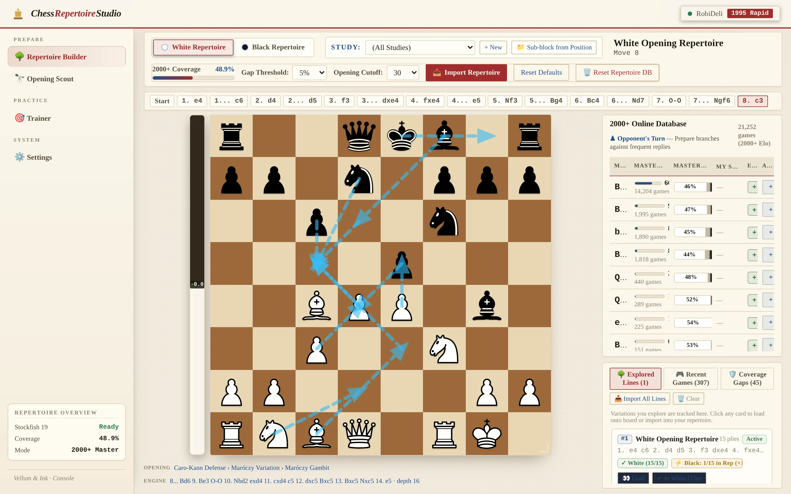

# ♔ Chess Repertoire Studio ♚

> **Personalized Chess Opening Platform, Interactive Repertoire Builder & Automated Leak Finder**  
> Directing AI agents and modern engineering to build a custom, distraction-free opening preparation and training suite for competitive play.

---



---

## 📖 Overview

**Chess Repertoire Studio** is a self-hosted, desktop-first chess opening workbench designed to bridge the gap between static opening theory and real-game execution.

As an active competitive online player ([`RobiDeli`](https://lichess.org/@/RobiDeli) on Lichess), commercial tools often feel either too rigid (forcing pre-packaged repertoires) or disconnected from real play. Chess Repertoire Studio solves this with a cohesive workflow:
1. **Curate your repertoire** with an interactive tree builder and named studies.
2. **Consult local Stockfish 19** and live Lichess Master (2000+) statistics at every node.
3. **Identify opening gaps** using an automated threat-scoring model that highlights frequent opponent sidelines.
4. **Detect real-game deviations** by syncing your recent Lichess games and pinpointing the exact half-move where you drifted from theory.
5. **Drill and retain lines** using spaced repetition (SRS) against opponent candidate moves.

---

## ⚡ Core Features

### 🌳 Interactive Repertoire Builder
- **Dual Repertoire Trees**: Dedicated, isolated opening trees for White and Black.
- **Sub-blocks & Studies**: Organize repertoires into named chapters (e.g., *Caro-Kann Fantasy*, *Sicilian Alapin*, *King's Indian*) and generate sub-blocks from any board state.
- **Interactive SVG Chessboard**: Fluid drag-and-drop piece movement, legal move highlights, notation breadcrumbs, and tactile audio feedback.
- **PGN Import & Export**: Import existing repertoires, ChessBase PGNs, or Lichess studies with full mainline and branch preservation.

### 🧠 Local Stockfish 19 UCI Engine
- **Local Engine Inference**: Bundled Stockfish 19 UCI binary running directly on hardware (zero external API latency).
- **Centipawn Evaluation Bar**: Live real-time evaluation with win-percentage conversion.
- **Multi-PV Candidate Arrows**: Visual engine candidate arrows overlaid directly onto the board.
- **Asynchronous Evaluation Pool**: Background analysis pipeline with Server-Sent Events (SSE) streaming updates to the UI.

### 📊 Lichess Master & Community Explorer
- **Deep Opening Statistics**: Real-time stats from over 2 million master games (2000+) and millions of Lichess games.
- **Threat-Scoring Formula**: Ranks candidate moves by their practical danger:
  ```text
  Threat Score = N × (L² + 0.02)
  where L = 1 - (Win% / 100)
  ```
  Prioritizes lines that are both frequently played against you and carry a high probability of loss if unprepared.
- **Opening Gap Finder**: Automatically flags high-frequency opponent replies where your repertoire currently lacks an answer.

### 🎯 Spaced Repetition (SRS) Trainer
- **Active Recall Drills**: Flashcard-style interactive board training where you play the correct repertoire moves against opponent sidelines.
- **Adaptive Scheduling**: Tracks retention, intervals, and blunder counts to review weak lines right before forgetting.

### 🔍 Automated Game Leak & Deviation Detector
- **Lichess API Account Sync**: Connect your Lichess account to automatically pull recent blitz, rapid, and classical games.
- **Exact Deviation Detection**: Compares every game against your saved repertoire, flagging the exact move where either you or your opponent diverged from theory.
- **Instant Targeted Drills**: Convert game blunders and preparation mistakes into 1-click drill sessions to reinforce the correct refutation.

### 🔭 Opening Scout & Lecture Discovery
- Discovers annotated video analyses, grandmaster lectures, and model games tailored to the exact position on the board.
- Synchronizes timestamped moves with the interactive board.

### 🎨 Editorial "Vellum & Ink" Console
- High-density, multi-pane workbench optimized for power users and widescreen displays.
- Distraction-free typography, warm contrast palette, and dark mode aesthetics.

---

## 🧱 Architecture & Tech Stack

Chess Repertoire Studio follows a lightweight, zero-bloat architecture:

| Subsystem | Technology | Purpose |
| :--- | :--- | :--- |
| **Backend API** | [FastAPI](https://fastapi.tiangolo.com/) + [Uvicorn](https://www.uvicorn.org/) | High-performance async REST endpoints and SSE evaluation streams |
| **Chess Engine** | Stockfish 19 UCI (`bin/stockfish/`) | Local asynchronous board evaluation and blunder detection |
| **Chess Logic** | [`python-chess`](https://python-chess.readthedocs.io/) | Legal move validation, FEN/PGN parsing, and SAN tree management |
| **Database** | SQLite 3 (WAL Mode) | Normalized positions, studies, moves, game caches, and SRS state |
| **Frontend** | Vanilla ES6+ JS, CSS Grid/Flexbox, HTML5 | Zero-build modern frontend (no webpack/vite/bundler required) |
| **Desktop Wrapper** | [Electron 44](https://www.electronjs.org/) | Native desktop application shell with tray launcher |

### Directory Structure

```
ChessImprovement/
├── backend/
│   ├── api.py               # REST API endpoints, SSE streams, CORS
│   ├── db.py                # SQLite schema, WAL configuration, migrations
│   ├── repertoire.py        # Tree manager, SRS algorithm, study grouping
│   ├── analyzer.py          # Stockfish blunder detection & centipawn evaluation
│   ├── evaluator.py         # Asynchronous engine worker pool
│   ├── deviations.py        # Real-game deviation scanner & drill generator
│   ├── scout_discovery.py   # Opening lecture and video scout
│   └── lichess_client.py    # Lichess API integration (Explorer & games)
├── frontend/
│   ├── index.html           # Console workbench layout
│   ├── board.js             # Interactive SVG chessboard component
│   ├── repertoire_builder.js# Repertoire builder workspace
│   ├── repertoire_trainer.js# Spaced repetition training engine
│   ├── scout.js             # Opening scout and video synchronizer
│   └── themes/              # "Vellum & Ink" editorial stylesheets
├── electron/
│   ├── main.js              # Electron lifecycle, spawns Python backend
│   └── icon.svg             # Application desktop icon
├── bin/
│   └── stockfish/           # Stockfish 19 UCI universal binary
├── tests/                   # 500+ unit & integration tests with temp DB isolation
├── start.py                 # CLI server launcher with health checks
└── run-desktop.sh           # Native desktop runner script
```

---

## 🚀 Getting Started

### Prerequisites
- **Python 3.10+**
- **Node.js 18+** (optional, only required if running via Electron desktop shell)
- **Stockfish 19** (bundled in `bin/stockfish/stockfish-linux-x86-64-universal`)

### 1. Installation

Clone the repository and install the dependencies:

```bash
git clone https://github.com/robindelis/ChessImprovement.git
cd ChessImprovement

# Install Python requirements
pip install fastapi uvicorn python-chess httpx python-dotenv

# (Optional) Install Electron for desktop mode
npm install
```

### 2. Environment Configuration

Copy the example environment file:

```bash
cp .env.example .env
```

Optional settings in `.env`:
```ini
# Port for the local server (default: 38281)
CHESS_PORT=38281

# Lichess Personal Access Token (for game sync & live ratings)
LICHESS_TOKEN=your_token_here

# Custom path to SQLite DB (defaults to ./chess_improvement.db)
CHESS_DB_PATH=chess_improvement.db
```

### 3. Launching the Application

#### Web Mode (Browser)
```bash
python3 start.py
```
Open your browser at **`http://127.0.0.1:38281`**.

#### Desktop Mode (Electron)
```bash
./run-desktop.sh
# or
npm start
```

---

## 🧪 Running the Test Suite

The project includes an extensive test suite verifying database transactions, FEN normalization, threat scoring, PGN imports, and Stockfish engine communication:

```bash
python3 -m unittest discover tests
```

*All 514+ tests execute against an isolated temporary in-memory database to prevent modifying user repertoires.*

---

## 👤 Author

**Robin De Lissnyder**
- Electromechanical Engineer (Robotics & AI) — ULB Polytech
- Portfolio: [robindelis.is-a.dev](https://robindelis.is-a.dev)
- Lichess: [@RobiDeli](https://lichess.org/@/RobiDeli)
- GitHub: [@robindelis](https://github.com/robindelis)

---

## 📄 License

This project is licensed under the ISC License. Stockfish is licensed under the GNU General Public License (GPL v3).
